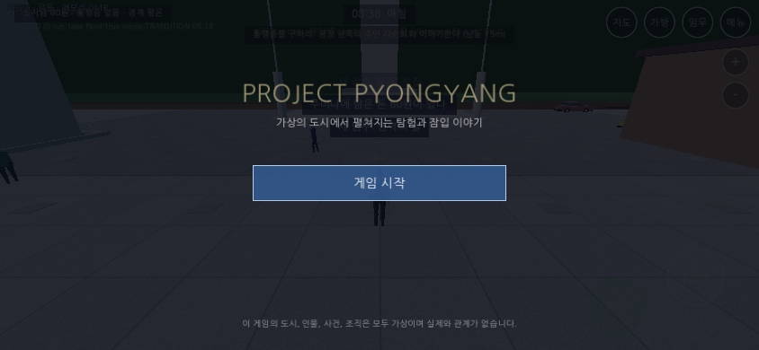
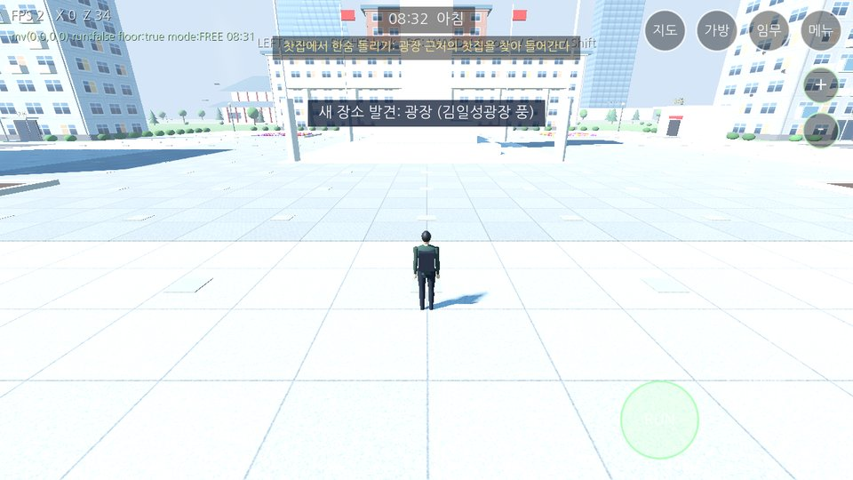
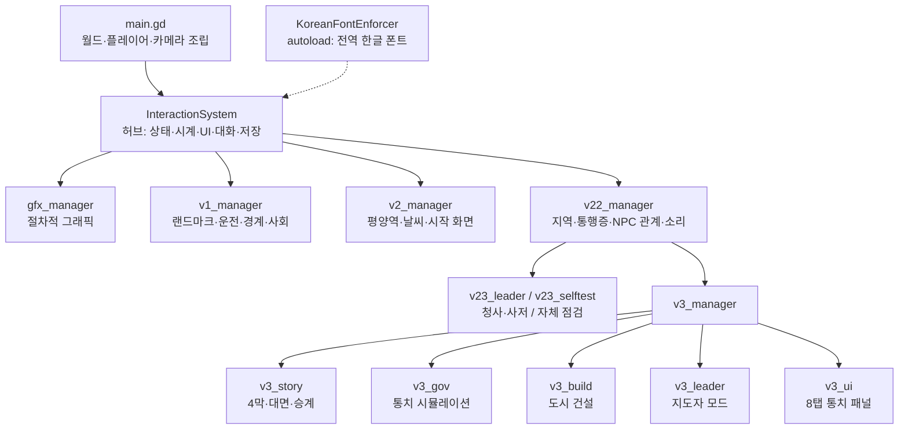
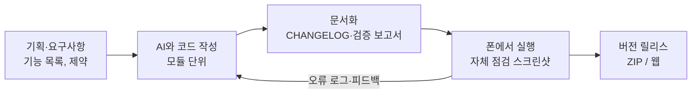
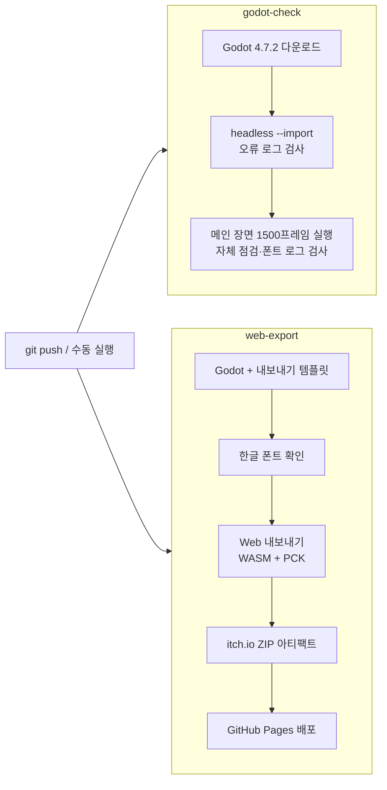
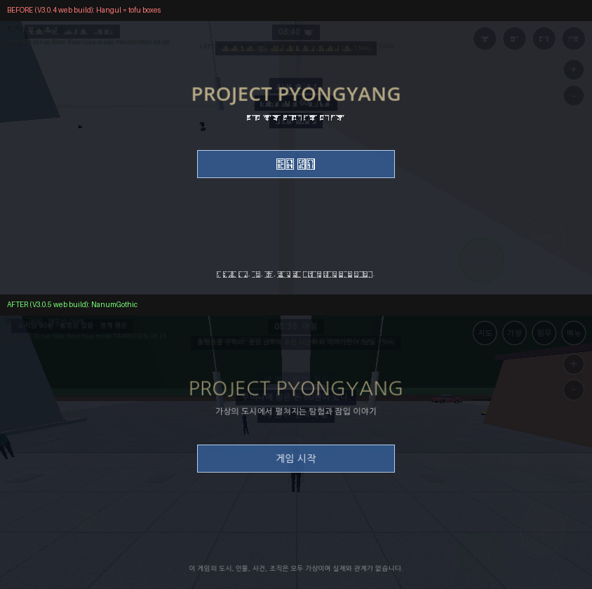

<div align="center">

# PROJECT PYONGYANG

**가상의 도시를 무대로 한 모바일 3D 오픈월드 잠입·통치 게임**

탐험하고, 사람들과 대화하고, 통행증을 구해 통제구역 깊숙이 들어가 —
마지막엔 집무실에서 내린 선택으로 도시의 운명을 직접 다스립니다.

[](https://sumin-kim-hub.github.io/PROJECT_PYONGYANG/)


[](https://github.com/Sumin-Kim-Hub/PROJECT_PYONGYANG/actions/workflows/godot-check.yml)
[](https://github.com/Sumin-Kim-Hub/PROJECT_PYONGYANG/actions/workflows/web-export.yml)

 

</div>

> **안내** — 이 게임의 도시·인물·조직·사건은 모두 창작한 **가상 설정**입니다. 실제 인물이나 사건을 재현하지 않으며, 폭력·유혈 묘사 없이 **탐험·대화·선택**으로만 진행됩니다.

---

## 목차
1. [바로 플레이하기 (링크 접속 방법)](#-바로-플레이하기)
2. [스토리](#-스토리)
3. [공략 가이드](#-공략-가이드)
4. [주요 기능](#-주요-기능)
5. [기술 스택](#-기술-스택)
6. [아키텍처와 설계 원리](#-아키텍처와-설계-원리)
7. [개발 워크플로우](#-개발-워크플로우)
8. [트러블슈팅 사례: 웹에서 한글이 □로 깨지던 문제](#-트러블슈팅-사례-웹에서-한글이-로-깨지던-문제)
9. [프로젝트 구조](#-프로젝트-구조)
10. [로컬에서 실행·빌드하기](#-로컬에서-실행빌드하기)
11. [검증 현황과 한계](#-검증-현황과-한계)
12. [크레딧](#-크레딧)

---

## 🎮 바로 플레이하기

### 👉 https://sumin-kim-hub.github.io/PROJECT_PYONGYANG/

설치 없이 브라우저에서 바로 실행됩니다. 링크만 보내면 친구도 같이 할 수 있습니다.

| 기기 | 접속 방법 |
|---|---|
| **PC** (Chrome·Edge·Firefox) | 링크를 열고 로딩이 끝나면 **게임 시작** 클릭 |
| **안드로이드** (Chrome) | 링크를 열고 **폰을 가로로** 돌린 뒤 시작 |
| **아이폰** (Safari) | 링크를 열고 **폰을 가로로** 돌린 뒤 시작 (주소창이 보일 수 있음) |

- **처음 로딩이 깁니다.** 엔진 파일(약 38MB)을 받기 때문에 Wi-Fi를 권장합니다. 두 번째부터는 브라우저 캐시로 빨라집니다.
- **세로 화면이면** "폰을 가로로 눕혀 주세요" 안내가 뜹니다. 가로로 돌리면 사라집니다.
- **저장은 브라우저 안에 됩니다.** 메뉴 › 저장을 눌러 두세요. 브라우저 데이터를 지우면 저장도 사라집니다.
- **소리는 첫 터치 이후에** 나옵니다(브라우저 정책).
- **느리면** 메뉴 › 설정에서 `저사양 모드`를 켜거나 그림자·군중 수·교통량을 줄이세요.

### 조작법

| 동작 | 터치 (모바일) | 키보드 (PC) |
|---|---|---|
| 이동 | 화면 **왼쪽**을 누르고 끌기 | `W` `A` `S` `D` |
| 카메라 회전 | 화면 **오른쪽** 빈 곳 끌기 | 방향키 |
| 달리기 / 점프 | `RUN` (켜고 끄기) / `JUMP` | `Shift` / `Space` |
| 상호작용 (대화·입장·앉기·문·조사·줍기·차 타기) | 가까이 가면 뜨는 **노란 둥근 버튼** | `E` |
| 대화 선택 | 선택지 누르기, 없으면 대화창 탭 | 마우스 클릭 |
| 운전 | 왼쪽 조이스틱(위=가속, 아래=브레이크·후진, 좌우=핸들), `JUMP`=핸드브레이크 | `W` `A` `S` `D` |
| 운전 시점 전환 | 시점 버튼 | `V` |
| 지도·가방·임무·메뉴 | 오른쪽 위 둥근 버튼 | 마우스 클릭 |
| 카메라 거리 | 오른쪽 위 `+` / `−` | 마우스 클릭 |
| 통치 메뉴 (지도자 모드) | 오른쪽 **통치** 버튼 | 마우스 클릭 |

---

## 📖 스토리

> *권력의 길 — 4막 캠페인*

당신은 신분을 감춘 채 거대한 도시에 들어온 이방인입니다. 광장과 아파트 단지, 강변 산책로와 장마당 사이로 사람들이 저마다의 일과를 살아갑니다. 도시 북쪽의 통제구역, 그리고 그 서쪽 가장 깊은 곳의 **중앙 청사** — 그곳에는 아무도 본 적 없는 **비공개 지출 장부**가 숨겨져 있다고 합니다.

| 막 | 제목 | 이야기 |
|---|---|---|
| **ACT 1** | 평양 잠입 | 도시를 돌아다니며 주민과 대화하고, 정보를 모으고, 통제구역으로 들어갈 **통행증**을 구한다. |
| **ACT 2** | 도시의 비밀 | 북부 검문소를 넘어 통제구역으로. 중앙 청사와 사저에 잠입해 **장부**를 손에 넣는다. |
| **ACT 3** | 최고지도자 관저 | 장부를 들고 집무실로 들어서면, 그동안 "지방 시찰 중"이던 **지도자**가 기다리고 있다. 대화는 당신이 걸어온 길을 되짚는다. |
| **ACT 4** | 권력 승계 | 당신이 쌓아 온 지지 기반에 따라 열리는 길 중 하나를 고른다. 그리고 **당신이 도시를 다스린다.** |
| **이후** | 자유 플레이 | 엔딩 뒤에도 같은 세계에서 통치·건설·탐험이 계속된다. |

### 네 가지 엔딩

| 길 | 엔딩 | 어떤 나라가 되는가 |
|---|---|---|
| 공개 개혁 | **A — 광장의 낭독** | 민심은 높지만 질서는 흔들린다. 인민 대표가 당신 편. |
| 군부 합의 | **B — 질서의 이름으로** | 안정은 단단하지만 민심은 차갑다. 군부 대표가 당신 편. |
| 조용한 거래 | **C — 닫힌 문 뒤의 서명** | 금고는 넉넉하다. 비서관과 경제 고문이 당신 편. |
| 유언 승계 | **D — 마지막 부탁** | 모든 것이 적당히 균형 잡힌 출발. 비서관과 경호대장이 당신 편. |

---

## 🗺 공략 가이드

> 화면 위쪽 가운데의 **한 줄 목표**가 항상 다음에 할 일을 알려 줍니다. 막히면 **임무** 버튼에서 단계 목록을 확인하세요.

### 튜토리얼 — 도시에 익숙해지기
1. 광장 근처에서 **"새 장소 발견"** 알림이 뜨면 찻집으로 갑니다. 입구의 노란 버튼으로 입장 → 주인 **한미정**과 대화 → 소파에 앉으면 첫 임무 완료, **소개장** 획득.
2. 소개장을 들고 행정사무소의 **박정숙**에게 가면 허가증을 받고, 안쪽 문서실에서 낡은 장부를 찾을 수 있습니다.
3. 시민에게 말을 걸 때 **마음 나누기**(선물·도움·경고)를 쓰면 신뢰도가 오릅니다. 사탕·차는 평양역 대합실 매점에서 구할 수 있습니다.

### ACT 1 — 통행증을 구하라
1. **광장 남쪽**(시작 지점 남쪽 약 40m)의 주민 **리순희**와 대화합니다.
2. **서쪽 장마당**의 상인 **한옥분**을 찾아갑니다.
3. 장마당 뒤쪽 창고의 **맨홀**로 내려가 비밀 지하 통로로 들어갑니다.
4. **지하 금고**의 숫자판은 암호가 필요합니다. 단서는 세 군데에 흩어져 있습니다 — **폐건물 · 강변 · 장마당**.
5. 금고에서 얻은 문서를 **보급관 오문철**(북쪽 검문소 앞)에게 넘길지, **연락장교 류**에게 전할지 정합니다. 선택에 따라 이후 지지 기반이 달라집니다.
6. **북부 검문소**를 통과하면 ACT 2가 시작됩니다.

> 💡 **검문소 팁** — 통행증이 없다면 **위조**하거나 **뇌물**을 쓸 수도 있습니다. 하지만 수상한 행동은 **도시 경계 단계**(평온 → 주의 → 경계 → 수색 → 비상)를 올립니다. 경계가 높으면 경찰이 출동하니, 잠시 숨어 기다리면 서서히 가라앉습니다.

### ACT 2 — 가장 높은 곳의 문
1. 통제구역 **서쪽 깊은 곳**의 중앙 청사 정문으로 갑니다. **특별 통행증**이 있으면 통과, 없으면 위조나 뇌물.
2. 청사 **비서실**에서 **사저 열쇠**를 구합니다(서랍을 뒤지거나 비서관과 거래).
3. 열쇠로 **사저**에 들어가 **서재**를 조사합니다. **먼지가 없는 책장**이 수상합니다.
4. 책장 뒤 **지하 대피소**에서 **비공개 장부**를 확보하고, 비상 갱도로 빠져나옵니다.

### ACT 3 — 집무실의 대면
장부를 가진 채 청사 **집무실(안쪽 큰 방)**에 들어서면 장면이 시작됩니다. 지도자는 "누구냐", "왜 왔느냐"를 묻고, 장부 이야기 끝에 **당신의 지지 기반**을 평가합니다.

| 지지 기반 | 이렇게 올린다 | 50 이상이면 열리는 길 |
|---|---|---|
| **주민** | 임무를 많이 완료하고(×5), 주민 신뢰를 쌓는다(×3) | 공개 개혁 (엔딩 A) |
| **군부** | 특별 통행증, 기지 카드, 명단, 명령서, 지하 통로 지도, 북부 검문소 통과 | 군부 합의 (엔딩 B) |
| **측근** | 장부, 결재 문서철, 비서관 열쇠, 훈장, 선물·시계, 서재 단서 | 조용한 거래 (엔딩 C) |
| — | 항상 열림 (안전장치) | 유언 승계 (엔딩 D) |

> 💡 **원하는 엔딩을 보려면** — 엔딩 A는 부가 임무와 주민 돕기를 열심히, 엔딩 B는 군사시설 쪽 물건을 빠짐없이, 엔딩 C는 청사·사저 안의 문서와 귀중품을 모두 챙기세요. 집무실에 들어가기 **직전에 저장**해 두면 여러 엔딩을 차례로 볼 수 있습니다.

### ACT 4 이후 — 통치 모드 공략
엔딩을 고르면 지도자 옷으로 갈아입고 경호원 2명과 수행 직원 1명이 따라다닙니다. 청사 정문은 자동 통과, 경비의 의심도 오르지 않습니다. 오른쪽 **통치** 버튼으로 8개 탭(국가 현황·예산·정책·도시 개발·주요 인물·회의·임무·저장)을 엽니다.

- **지표 6개** — 예산, 경제, 만족도, 발전도, 식량·자원, 안정도. 현실 시간 약 60초(게임 시간 2시간)마다 한 번 계산됩니다.
- **수입과 지출** — 수입은 경제·발전도·건물 수입에 비례하고, 지출은 유지비와 예산 배분 단계에 비례합니다. **처음엔 지출을 낮게 유지**하고 수입 건물부터 지으세요.
- **70의 벽** — 지표가 70을 넘으면 오르는 속도가 줄어듭니다. 한 지표만 올리기보다 **고르게** 관리하는 편이 효율적입니다.
- **위기 관리** — 식량 부족·빚·안정도 붕괴에는 불이익이 있습니다. 안정도가 바닥나면 비상 회복이 발동해 예산 −500, 만족도 −10의 큰 대가를 치릅니다.
- **정책 15개 / 건물 12종 / 회의 카드 12장 / 국정 목표 12개** — 정책은 대기 시간이 있으니 겹치지 않게 돌려 쓰고, 국정 목표를 달성하면 예산 보상을 받습니다.
- **건설** — 고스트가 **초록**이면 설치 가능, **빨강**이면 불가. 큰길·중앙 광장·청사 구역에는 지을 수 없습니다. 철거하면 50%를 돌려받습니다.
- **여가** — 집무실 창가에서 **도시 조망**(3개 시점), 사저 침대에서 아침까지 자기, 청사 앞에서 **전용 차량** 호출.

### 부가 임무

| 임무 | 힌트 |
|---|---|
| 정보원 접촉 | 대학생 최민호 → 호텔 안내원에게 "푸른 우산입니다" → 아파트 3동 책장 뒤 비밀 통로 |
| 운전 연습 / 택시 손님 | 큰길의 차에 타 보고, 택시 기사 정태수에게 목적지를 말하면 빠르게 이동 |
| 옥류관의 소문 · 지하철 점검실 | 서쪽 광장 옆 식당과 동쪽 지하철역 안쪽을 조사 |
| 평양역의 야간 열차 | 평양역 안내원 김혜정과 대화 (갈래 4개, 결말 2개) |
| 마음을 얻다 / 추적 따돌리기 | 시민 신뢰 쌓기 / 경찰 추격을 따돌리기 |
| 장마당의 거래 | 물건을 사고팔아 종잣돈 모으기 |
| 폐건물의 흔적 | 서쪽 외곽 폐건물에서 일기 쪽지와 녹슨 열쇠 |
| 강가의 약속 | 강변 낚시꾼 마씨에게 라디오 부품 전달 |
| 배급을 기다리는 사람들 | 동쪽 외곽 주거지 이웃 세 명에게 식량 나누기 |

---

## ✨ 주요 기능

- **절차적으로 생성되는 3D 도시** — 광장·아파트·강변·장마당·폐건물·빈민 주거지·통제구역·군사시설 등 9개 지역, 랜드마크 15곳, 들어갈 수 있는 실내 공간 15곳
- **살아 있는 시민** — 이름 있는 NPC와 군중이 시간대별 일과를 따르고, 신뢰도·소문·성격에 따라 대사가 바뀜
- **데이터 주도 대화·임무** — 조건(플래그·아이템·임무 단계·밤)과 효과(아이템 지급·문 열기·임무 진행)로 엮인 분기 대화, 18개 임무
- **잠입·경계 시스템** — 경비 시야와 의심 게이지, 목격자 신고, 5단계 도시 경계, 경찰 출동과 체포
- **통행증·검문소** — 통행증 등급, 위조, 뇌물, 불시 검사
- **운전** — 승용차·택시·트럭·버스·군용차, 택시 빠른 이동, 버스 정류장 승하차
- **날씨와 낮밤** — 맑음·흐림·비·안개, 12분 = 하루, 밤엔 창문과 가로등이 켜짐
- **통치·도시 건설 샌드박스** — 지표 6개, 정책·회의·국정 목표, 건물 배치(충돌 검사·고스트 미리보기)
- **자체 점검(Self-test)** — 게임이 켜지면 48개 항목을 스스로 검사해 화면과 로그에 결과 표시
- **저장/불러오기** — JSON 저장, 앱을 나가면 자동 저장

---

## 🛠 기술 스택

| 영역 | 사용 기술 |
|---|---|
| 엔진 | **Godot 4.7.2**, GDScript (72개 파일, 약 22,400줄) |
| 렌더링 | GL Compatibility (WebGL 2 / OpenGL ES 3) — 모바일·웹 공용 |
| 그래픽 | 외부 3D 에셋 없이 **100% 코드 생성** — loft 메시 캐릭터, 절차적 텍스처, MultiMesh |
| 배포 | Godot Web Export (WASM, 단일 스레드) → **GitHub Pages** |
| CI/CD | **GitHub Actions** — `godot-check`(헤드리스 검사), `web-export`(빌드·배포) |
| 검증 도구 | 헤드리스 Godot 로그 검사, 게임 내 자체 점검, Playwright 브라우저 점검, Python 시뮬레이션 모형 |
| 폰트 | 나눔고딕 (SIL Open Font License) |

---

## 🏗 아키텍처와 설계 원리

### 1. 허브-모듈 구조

장면 파일(`.tscn`)은 최소한만 두고 **월드·UI·시스템을 모두 코드로 조립**합니다. 중앙 허브(`interaction_system.gd`)가 버전별 모듈 매니저를 차례로 불러오고, 각 매니저는 자기 기능만 책임집니다.



### 2. 장애 격리 — 한 모듈이 깨져도 게임은 돈다
- 모든 모듈은 `load()` + `can_instantiate()`로 **동적으로** 불러옵니다. 한 파일에 컴파일 오류가 나도 그 기능만 빠지고 게임은 실행됩니다.
- `feature_flags.gd`의 스위치로 기능을 **버전 단위로 끄고 켤 수** 있습니다(`ENABLE_V3=false`면 V2.3 상태). 문제를 찾을 때 이분 탐색처럼 범위를 좁힐 수 있습니다.
- 모듈 생성에는 **시간 제한**이 있어, 느린 기기에서 한 모듈이 오래 걸리면 건너뛰고 나머지를 계속 진행합니다.

### 3. 데이터 주도 설계
대화와 임무는 코드가 아니라 **데이터**입니다. 대화 노드는 `조건 → 텍스트 → 선택지 → 효과`로 기술되고, 엔진은 이를 해석만 합니다.

```gdscript
# 형식 예시 (실제 데이터: scripts/data/npc_data.gd)
"start": {
    "text": "...",
    "variants": {"밤": "..."},                       # 시간대별 대사
    "choices": [
        {"label": "푸른 우산입니다", "next": "key",
         "if": {"quest": "q_contact", "min_step": 1},  # 조건
         "effects": [{"op": "give_item", "id": "apt_key"}]}  # 효과
    ]
}
```
새 NPC나 임무를 추가할 때 엔진 코드를 건드리지 않아도 되고, 조건·효과 연산자만 확장하면 새 버전 모듈이 기존 대화에 자연스럽게 끼어듭니다.

### 4. 에셋 없는 절차적 그래픽
- **캐릭터**: 단면을 쌓아 올리는 loft 메시로 몸·머리·옷을 만들고, 관절 노드 회전으로 걷기·달리기·앉기 애니메이션을 구현
- **건물**: 기존 박스 건물을 찾아 층별 창문 UV, 지붕, 발코니·에어컨 같은 디테일을 덧씌움
- **텍스처**: 외벽·아스팔트·잔디·물 등을 런타임에 생성하고 캐시
- **최적화**: 가로등·나무는 MultiMesh, NPC는 거리별 표시 범위(90m)·애니메이션 생략(70m), 그림자는 플레이어만, 모듈 생성은 프레임을 나눠 시작 멈칫을 줄임

### 5. 시뮬레이션은 따로 모형으로 검증
통치 시스템의 수치(수입·지출·체감·위기 장치)는 Python 모형(`tools/v3_gov_sim.py`)으로 옮겨 **4가지 엔딩 × 120틱**을 모의 실험했습니다. 방치하면 천천히 나빠지고 적극 운영하면 80~100에 수렴하도록 균형을 맞췄습니다.

### 6. 게임이 스스로를 검사한다
`v23_selftest.gd`는 게임 시작 9초 뒤 모듈 로딩, 데이터 무결성, 대화 그래프, 모의 통치, 건설 규칙 등 **48개 항목**을 읽기 전용으로 검사해 `통과 / 주의 / 실패`를 화면과 로그에 남깁니다. 이 로그가 CI의 합격 기준이 됩니다.

---

## 🔄 개발 워크플로우

### AI 페어 프로그래밍 + 실기기 테스트 루프

이 프로젝트는 **스마트폰의 Godot Android 에디터**에서 시작했습니다. 기획·방향 결정·실기기 테스트는 직접 하고, 코드 작성은 **AI 코딩 어시스턴트(Claude)**와 페어로 진행했습니다.



- **작게 쪼개고, 버전으로 쌓기** — 기능을 버전 단위 폴더(`v1/`, `v2/`, `v22/`, `v23/`, `v3/`)로 쌓고, 이전 버전 파일은 가능한 한 건드리지 않았습니다. 사용자가 직접 손본 핵심 파일(월드 배치·카메라 등)은 **보호 파일**로 지정해 수정하지 않았습니다.
- **정직한 기록** — 매 버전마다 무엇을 실행해 봤고 무엇을 못 해 봤는지를 `*_VERIFICATION_REPORT.md`, `DEVELOPMENT_LOG.md`에 구분해 남겼습니다.
- **실패에서 규칙 만들기** — V2.0에서 타입 추론 오류(`Cannot infer the type`)가 나자 V2.1에서 원인을 전수 수정하고 "타입 없는 값에 `:=` 금지"를 코딩 규칙으로 정했습니다.

### 버전 히스토리

| 버전 | 주요 내용 |
|---|---|
| v0.0.1 | 3D 도시 + 플레이어 + 터치 조작 프로토타입 |
| v0.1.0 | 상호작용·NPC 일과·건물 내부 6곳·임무 3개·저장 |
| v0.2.0 | 그래픽 전면 리뉴얼 — 절차적 캐릭터·건물·텍스처·하늘 |
| V1.0 | 랜드마크, 차량 운전, 도시 경계, 시민 반응·소문, 미니맵·설정 |
| V2.0 | 평양역, 날씨, 시작 화면, 부가 임무 |
| V2.1 | 긴급 복구 — 타입 추론 오류 전수 수정 |
| V2.2 | 새 지역 8곳, 지하 통로, 통행증·검문소, NPC 설득·거래, 랜덤 이벤트 |
| V2.3 | 중앙 청사·사저, 게임 내 자체 점검 |
| V3.0 | 4막 스토리 캠페인 + 통치·건설 샌드박스 |
| V3.0.1~2 | 택시 하차 버그 수정 |
| V3.0.3~4 | 웹(HTML5) 내보내기, GitHub Pages 자동 배포 |
| **V3.0.5** | **한글 폰트 파이프라인 수정, Godot 4.7.2 CI 통과, 웹 배포** |

### CI/CD 파이프라인



- Godot의 `--import`·`--quit`은 스크립트 오류가 있어도 종료 코드 0을 줄 수 있어, **종료 코드가 아니라 로그 내용**(`SCRIPT ERROR`, `Parse Error`, 기대 로그 존재 여부)으로 합격을 판정합니다.
- `--fixed-fps 60 --quit-after 1500`으로 **가상 시간 25초**를 빠르게 돌려, 9초 뒤 실행되는 자체 점검 결과까지 CI에서 확인합니다.

---

## 🔍 트러블슈팅 사례: 웹에서 한글이 □로 깨지던 문제

웹으로 배포하자 PC 에디터에서는 멀쩡하던 한글이 전부 □로 나왔습니다.



**원인 분석 — 세 가지가 겹쳐 있었습니다.**

| # | 증상 | 근본 원인 |
|---|---|---|
| 1 | 웹에서만 한글이 □ | 코드가 찾던 `ui_ko.otf`는 존재하지 않는 파일이었다. 데스크톱에서는 Godot 기본 폰트가 **OS 시스템 폰트로 대체**해서 가려졌지만, 브라우저(WASM)에는 대체할 시스템 폰트가 없다. |
| 2 | CI에서 `No loader found for resource: …ttf` | `project.godot`의 `gui/theme/custom`이 **엔진 시작 즉시**, 즉 리소스 import 전에 `.ttf`를 읽었다. 캐시(`.godot/`)가 없는 깨끗한 CI 환경에서는 항상 실패한다. |
| 3 | `Parse Error: Expected new line after "\"` | 이전 수정 시도에서 GDScript에 `\"Node\"`처럼 역슬래시로 이스케이프된 따옴표, 탭·공백 혼용이 들어갔다. |

**해결**
- 엔진 초기화 시점의 정적 폰트 로딩을 없애고, import가 끝난 뒤 실행되는 **autoload**(`KoreanFontEnforcer`)가 Theme을 읽어 `ThemeDB.fallback_font`와 엔진 기본 Theme의 `default_font`를 교체 → HUD·버튼·**3D 라벨(Label3D)**까지 한 번에 적용
- 실제 존재하는 폰트(나눔고딕, 한글 11,172자 전부 포함)를 저장소에 포함하고 `.import` 파일로 import 설정과 UID를 고정
- 깨진 스크립트는 원본으로 되돌리고 폰트 경로 한 줄만 수정 — **기존 기능은 그대로 유지**

**검증**
- 캐시 없는 깨끗한 복사본에서 `tools/godot_check.sh` 통과 (오류·경고 0, 자체 점검 48/0/0)
- 원본과 수정본을 각각 웹으로 내보내 헤드리스 크롬에서 실행·스크린샷 비교
- 엔진 안에서 Label·Button·CanvasLayer 아래 Label·Label3D가 모두 나눔고딕을 쓰는지 직접 검사
- GitHub Actions `godot-check`, `web-export` 모두 통과 후 Pages 배포

> 배운 점: **"내 컴퓨터에선 되는데"는 환경이 문제를 가리고 있을 수 있다.** 대상 플랫폼과 같은 조건(캐시 없는 CI, 시스템 폰트 없는 브라우저)에서 재현해야 근본 원인이 보인다.

---

## 📁 프로젝트 구조

```
PROJECT_PYONGYANG/
├── project.godot              # 엔진 설정 (GL Compatibility, autoload)
├── export_presets.cfg         # Web 내보내기 설정
├── scenes/main.tscn           # 유일한 장면 — 나머지는 전부 코드로 생성
├── assets/
│   ├── fonts/                 # NanumGothic.ttf (+ .import, OFL.txt)
│   └── theme/                 # default_korean_theme.tres
├── scripts/
│   ├── main.gd                # 조립 진입점
│   ├── core/                  # 게임 상태, 시계, 한글 폰트 autoload
│   ├── data/                  # NPC·임무·아이템 데이터, 기능 스위치
│   ├── interaction/           # 허브, 상호작용, 대화 UI
│   ├── interior/  npc/  city/ # 실내, NPC, 도시 소품·차량
│   ├── gfx/                   # 절차적 그래픽 (캐릭터·건물·하늘·텍스처)
│   ├── ui/                    # HUD
│   ├── v1/ v2/ v22/ v23/ v3/  # 버전별 기능 모듈
├── tools/
│   ├── godot_check.sh         # 헤드리스 로그 기반 검사
│   ├── web_smoke_test.py      # 브라우저 시작 점검
│   └── v3_gov_sim.py          # 통치 시뮬레이션 모형
├── .github/workflows/         # godot-check.yml, web-export.yml
└── docs/                      # 설계 문서, 테스트 가이드, 이미지
```

---

## 💻 로컬에서 실행·빌드하기

```bash
# 1. Godot 4.7.2로 프로젝트 열기 (에디터에서 project.godot 선택 후 ▶)

# 2. 헤드리스 검사 (CI와 동일)
bash tools/godot_check.sh /path/to/godot

# 3. 웹으로 내보내기 (내보내기 템플릿 설치 필요)
godot --headless --path . --import
godot --headless --path . --export-release "Web" build/web/index.html

# 4. 로컬에서 웹 빌드 실행
python3 -m http.server -d build/web 8000   # → http://localhost:8000
```

빠른 테스트용 스위치(`scripts/data/feature_flags.gd`):
- `V3_TEST_LEDGER = true` — 시작 7초 뒤 장부를 들고 청사 앞으로 이동 (ACT 3부터)
- `V3_TEST_LEADER = true` — 시작 7초 뒤 바로 통치 모드

---

## ✅ 검증 현황과 한계

| 항목 | 상태 |
|---|---|
| Godot 4.7.2 헤드리스 import·실행 (오류 0) | ✅ 확인 (로컬 + GitHub Actions) |
| 게임 내 자체 점검 48개 항목 | ✅ 48 통과 / 0 주의 / 0 실패 |
| Web 내보내기 + PC 크롬 실행 + 한글 표시 | ✅ 확인 |
| GitHub Pages 배포 | ✅ 배포 완료 |
| 실제 안드로이드·아이폰 브라우저 실행·성능 | ⬜ 미확인 |
| 4막 스토리·4개 엔딩 전체 수동 플레이스루 | ⬜ 미확인 |
| Android APK 내보내기 | ⬜ 미확인 |

**알려진 한계** — 캐릭터는 스키닝 없이 관절 회전 방식이라 관절이 겹쳐 보일 수 있고, 지도자와의 대면은 글 카드와 대화창 연출뿐이며(컷신·음성 없음), 웹은 앱보다 느리고 아이폰에서는 메모리 부족으로 꺼질 수 있습니다.

더 자세한 개발 기록은 [`DEVELOPMENT_LOG.md`](DEVELOPMENT_LOG.md), [`CHANGELOG.md`](CHANGELOG.md), [`TECHNICAL_ARCHITECTURE.md`](TECHNICAL_ARCHITECTURE.md), [`docs/V3.0_STORY_DESIGN.md`](docs/V3.0_STORY_DESIGN.md), 폰 테스트 안내는 [`README_KO.md`](README_KO.md)에 있습니다.

---

## 🙏 크레딧

- **기획·디렉션·테스트** — [Sumin-Kim-Hub](https://github.com/Sumin-Kim-Hub)
- **코드 작성 협업** — AI 코딩 어시스턴트 (Claude)
- **엔진** — [Godot Engine](https://godotengine.org/) (MIT License)
- **폰트** — 나눔고딕 © NHN Corporation, [SIL Open Font License 1.1](assets/fonts/OFL.txt)
- 3D 모델·텍스처·사운드는 외부 에셋 없이 모두 코드로 생성했습니다.
