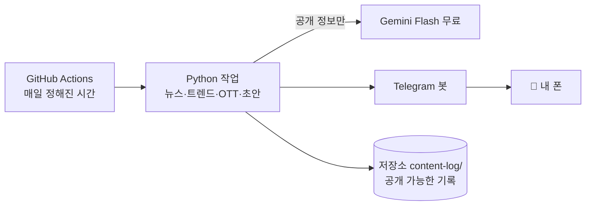
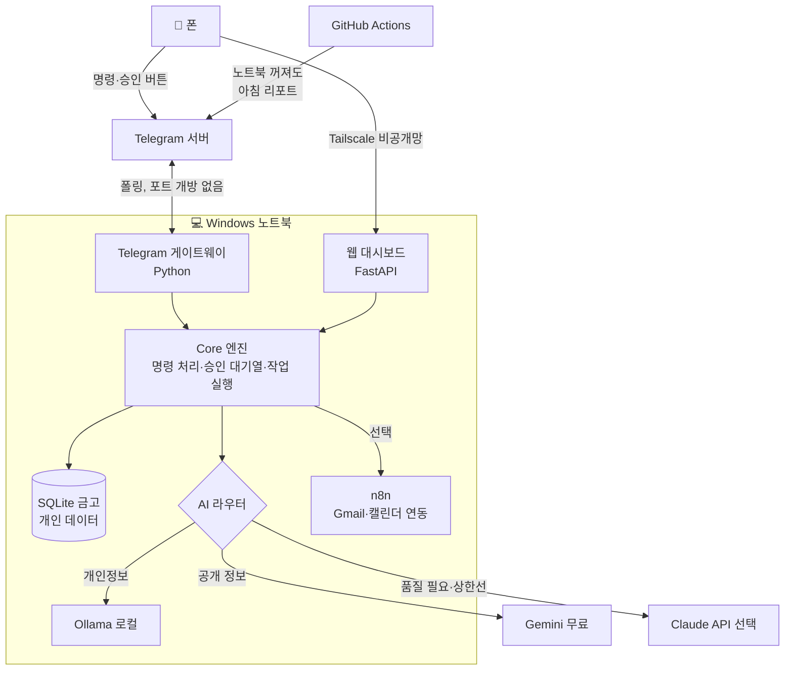

# ARCHITECTURE — 추천 시스템 구조

## 1. 핵심 아이디어 (비유)

- **Telegram** = 리모컨 (명령하고 보고받는 곳)
- **GitHub Actions** = 클라우드 알람시계 (정해진 시간에 공개 정보 작업 실행, 노트북 꺼져도 동작)
- **노트북 본체(Core)** = 집사 (대화형 명령, 개인 데이터, 승인 처리)
- **SQLite 금고** = 노트북 안의 개인 데이터 파일
- **GitHub 저장소** = 설계도·코드 보관함 (개인 데이터는 넣지 않음)
- **Claude Code** = 공장 (만들 때만 사용)

## 2. 두 단계 구조

### 단계 A — "폰만 있는 지금" (1~6단계)



- 상시 대화형 명령은 **아직 안 됨** (예약 작업 + 수동 실행 버튼만).
- 수동 실행: GitHub 앱에서 Actions → "Run workflow" 버튼, 또는 Claude Code에 요청.
- 개인정보는 이 단계에서 **다루지 않음**.

### 단계 B — "노트북 이후" (7~12단계)



## 3. 각 프로그램의 역할

| 구성요소 | 역할 | 기술 | 실행 위치 |
|---|---|---|---|
| Telegram 게이트웨이 | 명령 받기, 보고 보내기, 승인 버튼 처리. **내 chat_id만 응답** | python-telegram-bot (폴링) | 노트북 |
| Core 엔진 | 명령 해석 → 모듈 실행 → 결과 저장 → 보고 | Python 패키지 | 노트북 / Actions |
| 승인 대기열 | 외부로 나가는 모든 행동을 "대기" 상태로 저장, 승인 후 실행 | SQLite 테이블 + 감사 로그 | 노트북 |
| 예약 작업 | 아침 브리핑, 뉴스, 트렌드 | GitHub Actions cron / Windows 작업 스케줄러 | 클라우드 / 노트북 |
| AI 라우터 | 데이터 민감도에 따라 모델 자동 선택, 사용량 기록, 한도 초과 시 중단 | Python (`llm.py`) | 둘 다 |
| 대시보드 | 상태·예약표·소비 차트·기록 보기 | FastAPI + HTML + Pico.css | 노트북 |
| n8n (선택) | Gmail·캘린더처럼 로그인 연동 작업 | Docker | 노트북 (외부 비공개) |
| 데이터 금고 | 개인 데이터 | SQLite (+ 암호화 백업) | 노트북 |

## 4. AI 모델 연결 방식

모든 AI 호출은 **`llm.py` 한 곳**을 거칩니다.

```
ask(prompt, sensitivity="public" | "personal" | "secret", quality="low" | "high")
```

| sensitivity | 허용 모델 | 예 |
|---|---|---|
| `public` | Gemini 무료 → (실패 시) Claude Haiku | 뉴스 요약, 트렌드 |
| `personal` | Ollama 로컬, 또는 개인정보 제거 후 Claude API | 블로그 초안(내 경험 메모 포함) |
| `secret` | **Ollama 로컬만** (없으면 AI 없이 규칙 기반 계산) | 금융, 건강 |

- 매 호출마다 모델·토큰·예상 비용을 기록 → `/비용` 명령으로 확인
- 일/월 한도 초과 시 자동 중단 후 Telegram 알림
- 같은 질문은 결과 캐시 (중복 호출 방지)

## 5. Telegram 연동 방식

1. 사용자가 @BotFather에서 봇 생성 → 토큰 발급 (사용자 직접)
2. 토큰은 **GitHub Secrets / 노트북 `.env`** 에만 저장 (채팅·코드에 절대 붙여넣지 않음)
3. 허용 목록: `ALLOWED_CHAT_IDS` 에 내 chat_id만 → 다른 사람이 말 걸면 무시 + 기록
4. 명령 예시

| 명령 | 동작 |
|---|---|
| `/오늘` | 일정·할 일·출석 체크리스트·뉴스 요약 |
| `/상태` | 최근 작업 성공/실패, 다음 예약 |
| `/초안 블로그 <주제>` | 블로그 초안 생성 → 승인 버튼 |
| `/기록 <내용>` | 개인 메모 저장 |
| `/찾기 <단어>` | 내 메모·기록 검색 |
| `/비용` | 이번 달 AI 사용량 |
| `/승인대기` | 대기 중인 작업 목록 |

5. 승인 메시지: `[✅ 승인] [✏️ 수정] [❌ 거절]` 버튼. 24시간 무응답 시 자동 취소.

## 6. GitHub 관리 방식

- 저장소: `ai-command-center` (**Private**)
- 브랜치: `main` = 동작 확인된 버전만 / 작업은 기능 브랜치 → PR → 검증 후 합치기
- 자동 검사(Actions): 테스트 실행 + **비밀 정보 스캔(gitleaks)** — 실패하면 합치지 않음
- 이슈(Issues) = 할 일 목록, 각 로드맵 단계 = 마일스톤
- `docs/STATUS.md` = 현재 무엇이 실제로 동작하는지 (폰에서 GitHub 앱으로 확인)

### 폴더 구조 (예정)

```
ai-command-center/
├─ README.md            · docs/ (설계 문서, STATUS.md, RESUME.md)
├─ core/                Core 엔진: config, llm 라우터, storage, approvals, telegram
├─ jobs/                예약 작업: news_digest, trend_report, ott_picks
├─ modules/             content/ life/ finance/ assistant/ wellbeing/
├─ dashboard/           FastAPI + HTML
├─ workflows_n8n/       n8n 워크플로 내보내기(JSON, 비밀 제외)
├─ data/content-log/    공개 가능한 콘텐츠 기록만
├─ tests/
├─ .github/workflows/   daily-digest.yml, ci.yml
├─ .env.example         (빈 칸 예시만, 실제 값 없음)
└─ .gitignore           .env, *.db, data/private/ 등 제외
```

## 7. 데이터 저장 방식

| 데이터 종류 | 저장 위치 | GitHub |
|---|---|---|
| 코드, 문서, 설정 틀 | 저장소 | ✅ |
| 콘텐츠 초안·게시 기록 (공개 가능) | 저장소 `data/content-log/` (마크다운) | ✅ |
| 작업 로그 (개인정보 제거) | Actions 로그 / 노트북 | 일부 |
| 메모, 일정, 이메일 요약 | 노트북 SQLite | ❌ |
| 금융 (카드 내역 등) | 노트북 SQLite + 원본 파일은 분석 후 삭제 옵션 | ❌ |
| 건강·감정 기록 | 노트북 SQLite (별도 파일, 암호화) | ❌ |
| 비밀번호·API 키 | GitHub Secrets / 노트북 `.env` | ❌ |
| 백업 | 암호화 압축 파일 → 사용자 개인 클라우드/USB | ❌ |

개인 지식 검색: SQLite 내장 전문 검색(FTS5)으로 시작 → 부족하면 나중에 의미 검색 추가.

## 8. 모바일 웹 대시보드

- 단계 A: 대시보드 대신 **Telegram `/상태`** + GitHub 앱의 `docs/STATUS.md`
- 단계 B: 노트북의 FastAPI 대시보드
  - 화면: 홈(오늘 요약) / 작업 / 승인 대기 / 콘텐츠 예약표 / 소비 / 기록
  - 폰 화면 우선 디자인 (한 손 조작, 큰 버튼)
  - 접속: Tailscale 앱 켜고 `http://노트북이름:8000` — 인터넷에 공개 안 함
  - 로그인: 대시보드 비밀번호 1개 추가 (Tailscale + 비밀번호 2중)

## 9. Windows 노트북 이전 방법 (요약, 상세는 ROADMAP 11단계)

1. `winget`으로 Git, Python, VS Code, Tailscale 설치 (+ 필요 시 Docker Desktop, Ollama)
2. Claude Code 설치 → 저장소 복제
3. `.env.example` 을 복사해 `.env` 작성 (키는 직접 입력, GitHub 경유 금지)
4. `setup.ps1` 실행 (가상환경·패키지·DB 생성) → `selftest` 명령으로 점검
5. 작업 스케줄러 등록: 로그인 시 봇·대시보드 자동 시작
6. 절전 설정: 충전 중에는 잠자기 안 함 (선택)

## 10. 보안 및 인증 (요약, 상세는 COST_AND_SECURITY.md)

- Telegram: 허용 chat_id만 / 대시보드: Tailscale + 비밀번호
- 노트북 포트를 인터넷에 열지 않음 (폴링 + Tailscale)
- 외부 행동은 전부 승인 대기열 경유, 감사 로그 남김
- 금융은 **읽기 전용, 파일 가져오기 방식**. 은행·카드사 비밀번호를 시스템에 저장하지 않음
- 외부 스킬/플러그인 자동 설치 금지 (OpenClaw 사례 교훈)
